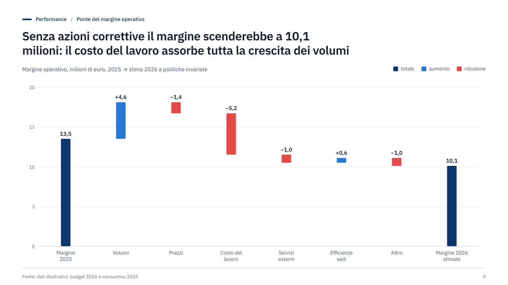

# Consulting Visual Library

Raccolta di grafiche HTML pronte per presentazioni di consulenza, in formato 16:9 (1280 × 720 px) e con uno stile uniforme. Ogni template funziona **offline**, si apre con un doppio clic e si adatta modificando un piccolo blocco di dati in testa al file.

Aprire **`index.html`** per sfogliare la galleria con le anteprime.



## Cosa contiene

| Area | Template |
|---|---|
| Base | Slide vuota da cui partire |
| Strategia | SWOT con implicazioni, matrice impatto/sforzo, Ansoff, PESTLE, cinque forze di Porter, portafoglio crescita/quota, albero dei driver |
| Performance | Cruscotto KPI, waterfall, benchmark con barre ordinate, andamento con proiezione, slopegraph, bullet graph, imbuto di conversione, mappa di calore |
| Processi e organizzazione | Processo a fasi (chevron), swimlane, piramide, organigramma, matrice RACI |
| Roadmap e pianificazione | Roadmap per filoni, timeline, Gantt, fasi e deliverable di una proposta |
| Sintesi executive | Executive summary, confronto tra opzioni, business case (VAN, TIR e tempo di recupero calcolati), raccomandazioni, matrice dei rischi |
| Slide visive (stile sito web) | Numero protagonista, copertina editoriale, bento, manifesto tipografico, racconto a punti, fascia sfumata, livelli isometrici, percorso a tappe, citazione a tutta pagina, sfondo animato 3D (Vanta), tre numeri animati (Motion) |

In totale 41 template, più due presentazioni complete. Tutti i dati presenti sono **illustrativi**.


## Come si usa un template

1. Aprire il file in `templates/<area>/` con il browser (Chrome, Edge, Firefox, Safari).
2. Per cambiare i numeri: aprire il file con un editor di testo e modificare il blocco marcato `===== MODIFICA QUI =====`. Titoli e testi descrittivi sono direttamente nell'HTML.
3. Per correggere i testi al volo: premere **E** nel browser, scrivere sulla slide, premere **Esc** per finire. Le modifiche non vengono salvate nel file: servono per una stampa o un PDF veloce.
4. Per ottenere un PDF 16:9: premere **P** e scegliere "Salva come PDF".
5. Per PowerPoint o Keynote: incollare il PDF o uno screenshot della slide, oppure usare l'immagine in `anteprime/`.

Ogni slide segue la stessa struttura: un **titolo-messaggio** (una frase che dice cosa concludere, non solo l'argomento), il contenuto, la **fonte** dei dati e il numero di pagina.

### Presentazione in stile sito web (WebSlides)

`presentazioni/webslides-esempio.html` usa [WebSlides](https://github.com/webslides/WebSlides) con il tema della libreria (`assets/webslides-tema.css`): copertina con luci in movimento, metriche, card con illustrazione, citazione, sfondo animato in 3D e una slide della libreria incorporata. Si naviga con le frecce o lo scorrimento; **Esc** mostra l'indice delle slide. Le classi di WebSlides (`bg-primary`, `flexblock metrics`, `card-50`, `text-quote`…) sono descritte nei demo ufficiali su webslides.tv/demos.

Altre risorse visive già verificate (componenti, illustrazioni, foto, sfondi) sono elencate in [`docs/RISORSE-VISIVE.md`](docs/RISORSE-VISIVE.md).

### Presentare più slide in sequenza

`presentazioni/esempio-reveal.html` mostra come montare una presentazione con [reveal.js](https://revealjs.com): ogni slide carica un template della libreria. Frecce per avanzare, **S** per le note del relatore, **F** per lo schermo intero. Per stampare l'intera presentazione in PDF aggiungere `?print-pdf` all'indirizzo e stampare dal browser.

### Inviare una sola grafica

```bash
python3 scripts/esporta-standalone.py waterfall
```

crea in `dist/` un file HTML unico con stili, caratteri e grafici incorporati, da inviare per email.

## Adattare la libreria a un cliente

Tutti i colori e il carattere sono definiti in `assets/theme.css`, nella sezione `:root`. Per adottare il brand di un cliente basta cambiare poche variabili:

| Variabile | Uso |
|---|---|
| `--brand` | Titoli di sezione, totali, elementi strutturali |
| `--focus` / `--focus-soft` | Il dato da evidenziare e la sua versione chiara |
| `--context` | Dati di contesto, in secondo piano |
| `--accent` | Richiami puntuali (messaggio chiave, "oggi", traguardi) |
| `--pos` / `--neg` | Variazioni favorevoli e sfavorevoli |
| `--font` | Carattere (incluso: IBM Plex Sans) |

Le slide visive hanno i colori scritti in testa a ciascun file (variabili `--bg`, `--ink`…), perché ognuna ha una propria direzione artistica.

Le serie categoriali `--s1`…`--s8` seguono un ordine verificato per la leggibilità da parte di chi ha difficoltà a distinguere i colori: se si cambiano, mantenere colori ben distinguibili e non usare più di tre serie nello stesso grafico a dispersione.

## Struttura

```
index.html                 galleria
catalogo.js                elenco dei template (alimenta la galleria)
assets/theme.css           stile comune e variabili di brand
assets/art.css             caratteri e animazioni delle slide visive
assets/webslides-tema.css  tema della libreria per WebSlides
assets/slide.js            adattamento allo schermo, tasti E e P, tema dei grafici
assets/fonts/              IBM Plex Sans (licenza OFL)
templates/<area>/*.html    i template
anteprime/<area>/*.png     anteprime generate automaticamente
presentazioni/             esempio di presentazione con reveal.js
vendor/                    librerie incluse: ECharts 6.1.0, reveal.js 6.0.2, WebSlides 1.5.0,
                           Vanta.js 0.5.24 con three.js r134, Motion 14.14.0
scripts/                   anteprime ed esportazione
docs/                      fonti, licenze e regole per nuovi template
```

## Aggiungere un template

Le regole sono in [`docs/AGGIUNGERE-UN-TEMPLATE.md`](docs/AGGIUNGERE-UN-TEMPLATE.md). In breve: partire da `templates/00-base/slide-vuota.html`, aggiungere la voce in `catalogo.js`, rigenerare le anteprime:

```bash
pip install playwright && playwright install chromium
python3 scripts/genera-anteprime.py
```

Lo script segnala anche errori JavaScript e testi che escono dallo spazio della slide.

## Fonti e licenze

Il codice della libreria è distribuito con licenza MIT (vedi `LICENSE`). Le librerie incluse mantengono le proprie licenze, riportate nelle rispettive cartelle. L'elenco delle fonti esterne utili per nuove idee, con licenza, versione e data di verifica, è in [`docs/FONTI.md`](docs/FONTI.md).
